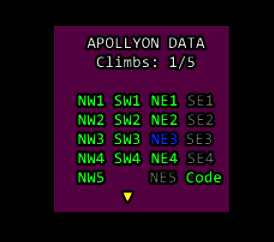

# Climbus™

**A Limbus progress tracker for Windower 4 (Final Fantasy XI).**

Climbus™ helps you keep track of your progress through **Temenos** and **Apollyon** without having to remember which data you've collected or which chest should come next; With the help of this addon you no longer need to reference the information, it is right in front of you.

## Features

- **Limbus data tracking:** Displays floor data for Temenos and Apollyon, with visual indicators for collected data.
- **Chest rotation tracking:** Records the order in which Limbus chests are opened and indicates which chest is next in the rotation.
- **Weekly climb tracking:** Shows progress toward the five weekly climbs for each Limbus area.
- **Code status:** Displays Code acquisition status separately for Temenos and Apollyon.
- **Multi-character synchronization:** Share chest-opening order with your other running Windower characters using a single command.
- **Persistent settings:** Retains tracked progress and chest-order settings between sessions.

## Screenshots



## Command

| Command | Description |
| --- | --- |
| `//climbus sync` | Sends the chest-opening order from the character issuing the command to all other characters currently running Climbus™. |

### Synchronizing chest order

If you're running multiple characters, enter the following command on the character whose chest-opening order you want to use:

```text
//climbus sync
```

That character's chest order is used as the source and replicated to the other running characters. **Run the command on the character with the correct order**, since it is the one being shared.

## How it works

Climbus™ detects whether you're in **Temenos** or **Apollyon** and displays the corresponding data and progress. It tracks temporary floor-data items, records chest-opening order, and shows your weekly climb count and Code status.

The display uses visual indicators to make it easier to see what you've collected and what remains. Chest-order information helps you decide which chest to open next.

## Installation

1. Place the `Climbus` addon folder in your Windower `addons` directory.
2. Load the addon in Windower:

   ```text
   //lua load Climbus
   ```

3. To load it automatically on startup, add the following line to your Windower startup script:

   ```text
   lua load Climbus
   ```

## Requirements

- Final Fantasy XI
- Windower 4

## Author

**Staticvoid**

---

*Climbus™ is a third-party Windower addon for Final Fantasy XI and is not affiliated with Square Enix.*
